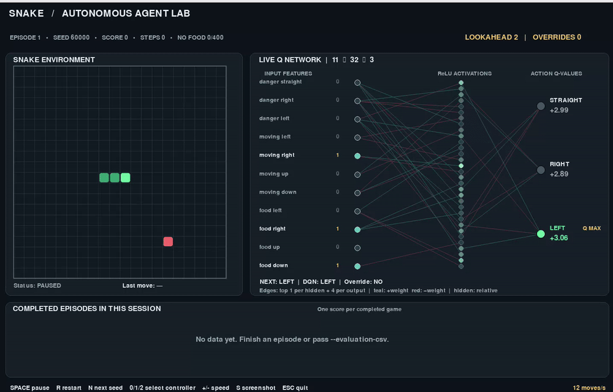

# Neural Network Snake AI

**Deep Q-Learning | Reinforcement Learning | Safety Lookahead**

An autonomous Snake-playing agent developed using a neural network implemented from scratch in NumPy.

The project explores how reinforcement learning enables an agent to learn through interaction with its environment, and how short-horizon safety planning can complement a learned policy.

## Demo



*Real-time autonomous gameplay with neural network activations, action Q-values, and optional safety lookahead.*

## Neural Network Architecture

The agent uses a fully connected neural network:

**11 Inputs → 32 Hidden Neurons (ReLU) → 3 Action Q-Values**

The network processes:

- Immediate collision danger
- Current movement direction
- Relative food direction

It estimates Q-values for three actions: straight, right, and left.

The neural network, forward propagation, backpropagation, and parameter updates are implemented using NumPy without PyTorch, TensorFlow, or automatic differentiation.

### Reinforcement Learning

The agent is trained using Deep Q-Learning (DQN), incorporating experience replay, a target network, epsilon-greedy exploration, and temporal-difference learning.

### Safety Lookahead

An optional safety controller simulates possible future movements before executing an action.

This allows the system to reject certain actions that would lead to immediate future traps.

The neural network remains responsible for the primary decision-making process.

## Experimental Results

Performance was evaluated across 100 identical environment seeds (71000–71099).

| Controller | Mean Score | Improvement |
|---|---:|---:|
| Pure DQN | 29.12 | Baseline |
| DQN + Lookahead 1 | 30.36 | +4.26% |
| DQN + Lookahead 2 | **32.96** | **+13.19%** |

The two-step controller improved 22 episodes, left 78 unchanged, and worsened none in this evaluation.

These results represent one trained network evaluated on a development seed set, not a guarantee of improvement across all training seeds.

All evaluated agents eventually experienced body collisions, highlighting the remaining limitations of short-horizon planning.

## Getting Started

### Requirements

- Python 3.12
- NumPy
- Pygame
- Matplotlib

### Installation

```bash
git clone https://github.com/weixiang1234/neural-snake-game.git
cd neural-snake-game

python3 -m venv .venv
source .venv/bin/activate

pip install -r requirements.txt
```

### Run the AI

```bash
python watch_dashboard.py \
    --checkpoint models/v1_episode450_policy.npz \
    --lookahead 2 \
    --speed 12
```

### Controls

| Key | Function |
|---|---|
| 0 | Pure DQN |
| 1 | One-step lookahead |
| 2 | Two-step lookahead |
| Space | Pause / Resume |
| R | Restart episode |
| N | Next episode |
| +/- | Adjust speed |
| S | Save screenshot |
| Esc | Exit |

## Testing

Run the automated tests:

```bash
python -m unittest discover -s tests -q
```

## Reproduce the Evaluation

```bash
python benchmark_safety.py \
    --checkpoint models/v1_episode450_policy.npz \
    --episodes 100 \
    --seed-start 71000 \
    --output-dir results/lookahead_eval_100
```

## Limitations

- The 11-feature observation does not describe the complete board.
- DQN performance can fluctuate during training.
- Short-horizon lookahead cannot prevent all future traps.
- Further evaluation across multiple independent training seeds is needed to establish robustness.

## Project Overview

This project demonstrates the integration of learned decision-making, neural network optimization, environment simulation, and model-based safety reasoning in a closed-loop autonomous system.